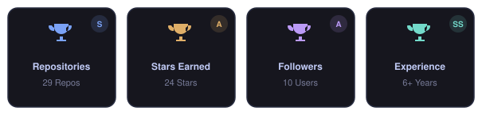

  <!-- Header Typing SVG -->

  

  

  Passionate about building scalable applications, solving challenging problems, and exploring new technologies.
  

  <!-- Social Badges -->
  

    
    &nbsp;
    

---

### 🛠️ Tech Stack & Architecture Toolkit

#### 💻 Programming Languages

  
  
  
  
  
  
  
  
  
  
  
  
  
  

#### ☁️ Cloud Platforms & Architecture

  <!-- AWS -->
  
  <!-- Google Cloud -->
  
  <!-- DigitalOcean -->
  
  <!-- Serverless / Architecture tools -->
  
  

#### 🔄 Data Engineering & Pipelines

  
  
  
  <!--  -->
  
  

#### 🧠 Data Science, ML & Analytics

  
  
  
  
  
  
  
  
  
  
  

#### 🗄️ Databases & Storage

  
  
  
  
  

#### 🐳 DevOps, Containers & Orchestration

  
  
  
  
  
  
  
  
  
  

#### 🤖 Artificial Intelligence & Generative AI

  
  
  
  
  
  
  

#### 🔗 LLM Frameworks & RAG Architecture

  
  
  
  
  <!--  -->

#### 🔍 Vector Databases & Semantic Search

  
  
  
  <!--  -->
  

#### ⚙️ MLOps & Model Evaluation

  
  
  
  
  <!--  -->

#### Tools

#### IDEs

---

### 📊 GitHub Analytics

  

    
    
    
  

  

  
  

<picture>
  <source media="(prefers-color-scheme: dark)" srcset="./profile/snake-dark.svg" width="50%"/>
  <source media="(prefers-color-scheme: light)" srcset="./profile/snake.svg" width="50%"/>
  
</picture>

---

### ⚡ Quick About Me

- 🔭 I’m currently working on: *Self Improvement*
- 🌱 I’m currently learning: *Everything*
- 💬 Ask me about: 
- 📫 How to reach me: *Via [LinkedIn](https://linkedin.com/in/tamjidahsan) or [mail](mailto:tamz888@yahoo.com)*

---

  
  &nbsp;
  <!-- 
  &nbsp;
   -->
  
&nbsp;

  &nbsp;
  

---

  

  
  
  
  

